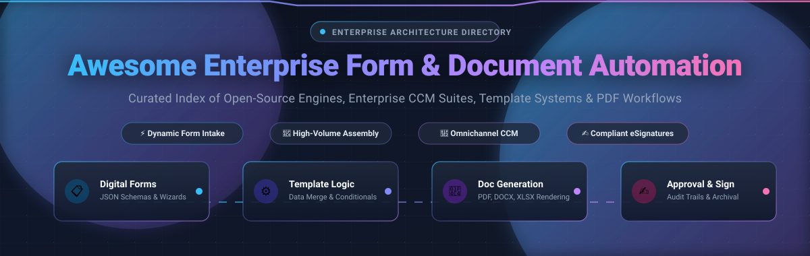

<<<<<<< HEAD
# Awesome-Enterprise-Form-Document-Automation

=======
<div align="center">



# ⚡ Awesome Enterprise Form & Document Automation 📄

<p align="center">
  <a href="https://github.com/ishandutta2007/Awesome-Awesome-Awesome"></a><a href="https://discord.gg/jc4xtF58Ve"></a>
  <a href="https://github.com/ishandutta2007/Awesome-Enterprise-Form-Document-Automation/stargazers"></a>
  <a href="https://github.com/ishandutta2007/Awesome-Enterprise-Form-Document-Automation/network/members"></a>
  <a href="LICENSE"></a>
  <a href="https://github.com/ishandutta2007/Awesome-Enterprise-Form-Document-Automation/commits/main"></a>
  <a href="https://github.com/ishandutta2007"></a>
</p>

<p align="center">
  <strong>A curated, SEO-optimized directory of enterprise Customer Communications Management (CCM), dynamic web form engines, automated document generation APIs, headless PDF rendering pipelines, and production-grade open-source software.</strong>
</p>

---

</div>

## 📑 Table of Contents

- [🌟 Overview & Core Architecture](#-overview--core-architecture)
- [📊 Sector Overview & Market Dynamics](#-sector-overview--market-dynamics)
- [🏢 SaaS & Hosted Enterprise Platforms](#-saas--hosted-enterprise-platforms)
- [💻 Open-Source GitHub Projects](#-open-source-github-projects)
- [🛠️ Architectural Building Blocks & Frameworks](#️-architectural-building-blocks--frameworks)
- [🔍 SEO & Technology Taxonomy](#-seo--technology-taxonomy)
- [🤝 How to Contribute](#-how-to-contribute)
- [💖 Support & Sponsorship](#-support--sponsorship)
- [📈 Star History](#-star-history)
- [⚖️ Disclaimer](#%EF%B8%8F-disclaimer)

---

## 🌟 Overview & Core Architecture

**Enterprise Form & Document Automation** represents the technological backbone for digital onboarding, regulated client communication, batch billing, contract assembly, and dynamic data capture. It bridges customer intake forms with high-fidelity document generation engines, enterprise resource planning (ERP) databases, customer relationship management (CRM) platforms, and legally binding eSignature workflows.

```
┌──────────────────────┐       ┌──────────────────────┐       ┌──────────────────────┐       ┌──────────────────────┐
│  📋 Interactive Form  │ ───▶  │  ⚙️ Template & Data  │ ───▶  │  📄 High-Volume PDF  │ ───▶  │  ✍️ eSign, Delivery  │
│  Intake & Validation │       │  Merging Engine      │       │  & Office Rendering  │       │  & Records Archival  │
└──────────────────────┘       └──────────────────────┘       └──────────────────────┘       └──────────────────────┘
       │                              │                              │                              │
       ▼                              ▼                              ▼                              ▼
 • Adaptive Wizards             • JSON Schema & XML             • Headless Chromium/Blink      • Cryptographic Signatures
 • Real-Time Field Rules        • Dynamic Conditional Loops     • Print Streams (AFP/PostScript)• Long-Term PDF/A Compliance
 • CRM/ERP Ingestion            • Multilingual Localization     • Pixel-Perfect Pagination     • Secure Vault & Audit Trails
```

### 🎯 Key Evaluation Pillars
- **⚡ Dynamic Form Intake & Schema Orchestration**: Drag-and-drop web form builders, guided wizard interviews, conditional field branching, and bidirectional REST/GraphQL data binding.
- **📄 High-Throughput Document Assembly**: Template-driven merging across DOCX, XLSX, PPTX, HTML, and PDF formats with precision typography, pagination controls, and barcode/QR generation.
- **🏢 Omnichannel Customer Communications Management (CCM)**: Batch statement composition, transactional notification dispatch (email, SMS, print-ready AFP/PCL), and real-time interactive document authoring.
- **🛡️ Regulatory Compliance & Digital Governance**: Built-in support for PDF/A long-term archiving, accessibility standards (Section 508 / PDF/UA), SOC 2 Type II, HIPAA, GDPR, and tamper-evident audit trails.

---

## 📊 Sector Overview & Market Dynamics

> 📈 **Market Insights**: The global Enterprise Form and Document Automation market (encompassing Customer Communications Management, Document Generation, and Dynamic Web Forms) is estimated at **~$6.2 Billion in 2026** and is projected to expand to **~$16.8 Billion by 2033**, compounding at a robust CAGR of **~13.8%**.
> 
> 🧩 **Fragmentation & Competitive Landscape**: The sector is **moderately fragmented**. High-volume, mission-critical batch communications in banking, insurance, healthcare, and utilities remain strongly anchored by legacy enterprise CCM incumbents (*Oracle, Adobe, OpenText, Quadient*). Concurrently, rapid enterprise SaaS adoption and product-led growth are driven by agile cloud workflow platforms (*Nintex, airSlate, PandaDoc, Formstack*), while modern cloud-native engineering teams increasingly implement modular, self-hosted, and headless open-source rendering engines (*Typst, Stirling-PDF, Gotenberg, Carbone, Documenso*) to retain complete data sovereignty.

---

## 🏢 SaaS & Hosted Enterprise Platforms

*The premier commercial SaaS and enterprise-hosted document and form automation suites, ranked in descending order by **Company Size (Valuation / Market Cap / Annual Revenue)**.*

| Platform 🚀 | Company Size (Valuation / Revenue) 🏢 | Description & Key Capabilities 📝 | Starting Price 💵 | Free Tier / Free Trial Limits 🆓 |
| :--- | :--- | :--- | :--- | :--- |
| **[Oracle Forms & Reports / OCI Document Understanding](https://www.oracle.com/cloud/data-science/document-understanding/)** | **~$480 Billion** Market Cap *(NYSE: ORCL; ~$53B Annual Revenue)* | Mission-critical enterprise transaction form engine paired with cloud AI document understanding for high-volume automated data capture, financial statement batching, and ERP ledger integration. | **$0.001 / page** *(OCI Document Understanding text/table extraction; $460/Named User perpetual for Oracle Forms)* | **OCI Always Free Tier:** 5,000 document pages/month free forever for Document AI; plus **30-day free trial** with **$300 cloud credits**; 30-day eval for on-prem Oracle Forms. |
| **[Adobe Experience Manager (AEM) Forms](https://business.adobe.com/products/experience-manager/forms/aem-forms.html)** | **~$250 Billion** Market Cap *(NASDAQ: ADBE; ~$21.5B Annual Revenue)* | Enterprise successor to Adobe LiveCycle; delivers end-to-end adaptive form experiences, dynamic server-side PDF document generation, interactive statement assembly, and electronic signatures. | **$0.05 / transaction** *(Adobe PDF Services API pay-as-you-go; $250/month Starter tier for 5,000 document merges; AEM cloud from ~$40k/yr)* | **Permanent Free Tier:** 500 document generation/extraction transactions per month free forever; or **6-month developer trial** with 1,000 free API transactions (no credit card required). |
| **[DocuSign Gen & Agreement Cloud](https://www.docusign.com/products/gen-for-salesforce)** | **~$13.2 Billion** Market Cap *(NASDAQ: DOCU; ~$2.8B Annual Revenue)* | Dynamic document generation and lifecycle automation engine embedded directly into Salesforce and cloud CRMs for single-click contract assembly, quote generation, and approval routing. | **$20 / user / month** *(DocuSign Gen for Salesforce add-on billed annually; eSignature base starts at **$10/month**)* | **Free Forever Edition:** Send up to 3 document envelopes free for life; plus **30-day free trial** of Business Pro with unlimited test document generation and eSignatures. |
| **[OpenText Exstream](https://www.opentext.com/products/exstream)** | **~$9.0 Billion** Market Cap *(NASDAQ: OTEX; ~$5.8B Annual Revenue)* | Flagship enterprise Customer Communications Management (CCM) powerhouse engineered for ultra-high-volume batch, on-demand transactional document assembly, and multichannel delivery. | **~$1,500 / month** *(Base mid-market deployment for OpenText Core Experience / Exstream Cloud; ~$18,000/year annual contract)* | **30-day free sandbox trial** with up to 250 test document generations and template designer access via OpenText Developer Cloud portal. |
| **[Kofax TotalAgility (Tungsten Automation)](https://www.tungstenautomation.com/products/totalagility)** | **~$3.2 Billion** Valuation *(Clearlake Capital & TA Associates; ~$650M+ Revenue)* | Enterprise intelligent automation platform combining dynamic intake forms, cognitive AI document capture, process orchestration, and automated communications generation. | **~$650 / month** *(Base entry cloud tier for up to 5,000 document processing & form orchestration pages/month)* | **30-day full-feature trial** including 5,000 extraction pages, web form designer, workflow engine, and pre-built solution templates (no credit card required). |
| **[Nintex Forms & Process Automation](https://www.nintex.com/process-automation/forms/)** | **~$2.8 Billion** Valuation *(TPG Capital; ~$250M+ ARR)* | Enterprise no-code responsive form builder, workflow routing, and automated document generation integrated seamlessly with Microsoft SharePoint, Office 365, and Salesforce. | **$2,083 / month** *(Billed annually at $25,000/year for Nintex Pro tier with unlimited users and up to 10 automated form workflows)* | **30-day free trial** with full platform capabilities, up to 10 automated forms and workflows, unlimited users, and template designer (no credit card required). |
| **[Conga Composer](https://conga.com/products/composer-document-generation)** | **~$2.7 Billion** Valuation *(Thoma Bravo; ~$350M+ ARR)* | Enterprise document automation suite for Salesforce and enterprise CRMs, compiling quotes, invoices, proposals, and contracts into pixel-perfect Word, PDF, and PowerPoint deliverables. | **$20 / user / month** *(Billed annually with a 5-user minimum = **$100 / month** base; Conga Contract Automation add-ons available)* | **30-day free trial** on Salesforce AppExchange with 100 test document generation merges and drag-and-drop template builder access. |
| **[SmartIQ by Smart Communications](https://www.smartcommunications.com/products/smartiq/)** | **~$1.4 Billion** Valuation *(Accel-KKR; ~$180M+ ARR)* | Enterprise adaptive interview and dynamic form-to-document automation platform (formerly Intelledox Infiniti) built for complex insurance intake, banking onboarding, and customer communications. | **~$2,200 / month** *(Dedicated enterprise cloud tenant starting at $26,400/year for interview-to-document automation workflows)* | **30-day developer partner sandbox** with up to 5 seats and 250 test interview document runs upon verified partner request. |
| **[airSlate Document Automation](https://www.airslate.com/)** | **~$1.25 Billion** Valuation *(Series B Unicorn backed by General Catalyst & Morgan Stanley; ~$150M+ ARR)* | All-in-one no-code workflow automation platform combining interactive web forms, dynamic PDF generation, contract negotiation, automated bots, and native e-signatures. | **$30 / flow-creator / month** *(Billed annually for airSlate Flow Automation; standalone pdfFiller starts at **$8/user/month**)* | **30-day free trial** with complete access to flow builders, automated document bots, CRM connectors, and unlimited test signers (no credit card required). |
| **[PandaDoc](https://www.pandadoc.com/)** | **~$1.1 Billion** Valuation *(Series C Unicorn backed by OMERS & Altos; ~$100M+ ARR)* | Document automation and CPQ platform empowering sales and operations teams to generate, track, approve, and e-sign personalized proposals, quotes, and interactive contracts. | **$19 / user / month** *(Billed annually at $228/year for Essentials tier; Business tier with CRM integrations starts at **$49/user/month**)* | **Free Forever Plan:** Unlimited document uploads and unlimited legally-binding eSignatures; plus **14-day free trial** for Business tier features. |
| **[Quadient Inspire](https://www.quadient.com/customer-communications/inspire-flex)** | **~$950 Million** Market Cap *(Euronext: QDT; ~€1.06B / $1.15B Annual Revenue)* | Comprehensive enterprise customer communications management (CCM) solution for personalized statement creation, dynamic batch generation, and interactive customer correspondence. | **~$1,200 / month** *(Billed annually at ~$14,400/year base deployment for Quadient Inspire Flex / Cloud entry package)* | **14-day guided proof-of-concept trial** with up to 500 document generation batch samples upon enterprise demo verification. |
| **[Formstack Documents](https://www.formstack.com/products/documents)** | **~$850 Million** Valuation *(Silversmith Capital & PSG; ~$130M ARR)* | Flexible web form builder and cloud document merge software automating PDF, Word, and Excel generation from online form submissions, CRM webhooks, and third-party apps. | **$92 / month** *(Billed annually at $1,104/year for Formstack Documents Starter plan with up to 350 merges/month; Forms starts at **$50/month**)* | **14-day free trial** with up to 50 test document merges, full access to drag-and-drop document template builder, no credit card required. |
| **[Experlogix Document Automation](https://www.experlogix.com/document-automation/)** | **~$450 Million** Valuation *(Pamlico Capital; ~$60M ARR)* | Document generation and CPQ automation platform tightly integrated into Microsoft Dynamics 365 and Salesforce for complex multi-entity quotes, proposals, and customer communications. | **$20 / user / month** *(Billed annually, 5-user minimum = **$100 / month** base for standard Dynamics/Salesforce template automation)* | **14-day free trial** via Microsoft AppSource and Salesforce AppExchange with full template designer and up to 100 test document generation merges. |

---

## 💻 Open-Source GitHub Projects

*Active open-source platforms, dynamic form builders, headless document rendering engines, and interview assembly tools, **ranked in descending order by GitHub Star Count**.*

| Repository & Platform 🌐 | GitHub Stars ⭐ | Primary Tech 💻 | Description & Key Architectural Features 📝 |
| :--- | :--- | :--- | :--- |
| **[Stirling-PDF](https://github.com/Stirling-Tools/Stirling-PDF)** | [](https://github.com/Stirling-Tools/Stirling-PDF/stargazers) | Java / TypeScript | Self-hosted, robust web-based PDF Swiss Army knife providing PDF form filling, split/merge, automated OCR, password protection, and REST API endpoints for document processing. |
| **[Typst](https://github.com/typst/typst)** | [](https://github.com/typst/typst/stargazers) | Rust | Next-generation markup-based typesetting system and high-performance document compiler; an extraordinarily fast, modern programmatic alternative to LaTeX for dynamic PDF generation. |
| **[Paperless-ngx](https://github.com/paperless-ngx/paperless-ngx)** | [](https://github.com/paperless-ngx/paperless-ngx/stargazers) | Python / TypeScript | Supercharged document management system (DMS) transforming physical and scanned PDF invoices, intake forms, and records into searchable digital assets with automated OCR and tagging. |
| **[jsPDF](https://github.com/parallax/jsPDF)** | [](https://github.com/parallax/jsPDF/stargazers) | JavaScript | Battle-tested client-side and Node.js HTML5 library for programmatic PDF creation, vector shape drawing, text formatting, and tabular document rendering directly in web applications. |
| **[react-jsonschema-form](https://github.com/rjsf-team/react-jsonschema-form)** | [](https://github.com/rjsf-team/react-jsonschema-form/stargazers) | TypeScript | Industry-standard React component library that dynamically renders full HTML forms from JSON Schema specifications, supporting custom field widgets, conditional rules, and validations. |
| **[Documenso](https://github.com/documenso/documenso)** | [](https://github.com/documenso/documenso/stargazers) | TypeScript | The open-source DocuSign alternative; developer-first digital signature and document signing platform providing cryptographic signing, webhook automations, and self-hosted infrastructure. |
| **[Gotenberg](https://github.com/gotenberg/gotenberg)** | [](https://github.com/gotenberg/gotenberg/stargazers) | Go / Docker | Docker-powered stateless REST API for high-volume conversion of HTML, Markdown, and Office documents (DOCX, XLSX, PPTX) into PDFs using headless Chromium, LibreOffice, and PDFtk. |
| **[Formbricks](https://github.com/formbricks/formbricks)** | [](https://github.com/formbricks/formbricks/stargazers) | TypeScript / Next.js | Privacy-first open-source survey and form suite; provides granular user targeting, multi-step interview logic, webhooks, and seamless embedding into web apps for customer data intake. |
| **[Typebot](https://github.com/baptisteArno/typebot.io)** | [](https://github.com/baptisteArno/typebot.io/stargazers) | TypeScript | Conversational form builder and automated intake platform; turns tedious web forms into dynamic chat experiences with visual workflow builders and multi-system webhook sync. |
| **[WeasyPrint](https://github.com/Kozea/WeasyPrint)** | [](https://github.com/Kozea/WeasyPrint/stargazers) | Python / C | Visual rendering engine turning HTML5 and CSS3 documents into standard-compliant PDFs with complete support for paged media standards, running headers, footers, and bleed boxes. |
| **[Flowable Engine](https://github.com/flowable/flowable-engine)** | [](https://github.com/flowable/flowable-engine/stargazers) | Java | Enterprise open-source BPMN, CMMN, DMN, and dynamic Form engine powering complex multi-stage human approval workflows, case management, and business document routing. |
| **[pdf-lib](https://github.com/Hopding/pdf-lib)** | [](https://github.com/Hopding/pdf-lib/stargazers) | TypeScript | Cross-runtime JavaScript library to create and modify PDF documents in any JS environment (Node, browser, Deno); supports filling PDF AcroForms, merging pages, and embedding fonts. |
| **[pdfme](https://github.com/pdfme/pdfme)** | [](https://github.com/pdfme/pdfme/stargazers) | TypeScript / React | Developer-friendly PDF generation and document automation library featuring a visual WYSIWYG template designer and pure JavaScript rendering engine with zero heavy dependencies. |
| **[SurveyJS](https://github.com/surveyjs/survey-library)** | [](https://github.com/surveyjs/survey-library/stargazers) | TypeScript | Full-scale open-source form builder and dynamic survey library for React, Angular, Vue, and plain JS; renders complex JSON-driven forms with multi-page branching and PDF export. |
| **[Camunda BPM Platform](https://github.com/camunda/camunda-bpm-platform)** | [](https://github.com/camunda/camunda-bpm-platform/stargazers) | Java | Flexible open-source framework for workflow and business process automation; integrates embedded task forms, decision automation (DMN), and document generation service tasks. |
| **[docxtemplater](https://github.com/open-xml-templating/docxtemplater)** | [](https://github.com/open-xml-templating/docxtemplater/stargazers) | JavaScript | Deep template engine for DOCX, PPTX, and XLSX files; replaces placeholders, loops over data rows, renders conditional sections, and inserts images into Office templates via JSON. |
| **[OhMyForm](https://github.com/ohmyform/ohmyform)** | [](https://github.com/ohmyform/ohmyform/stargazers) | JavaScript | Open-source alternative to Typeform and Google Forms for self-hosting custom forms and intake surveys with customizable UX and RESTful submission endpoints. |
| **[Maroto](https://github.com/johnfercher/maroto)** | [](https://github.com/johnfercher/maroto/stargazers) | Go | Fast, programmatic PDF generator for Golang inspired by Bootstrap grid layouts; ideal for building high-speed transactional invoices, delivery receipts, and automated reports. |
| **[Form.io](https://github.com/formio/formio)** | [](https://github.com/formio/formio/stargazers) | JavaScript | Combined drag-and-drop form builder and backend data management platform for progressive web apps; natively generates automatic JSON schemas and RESTful APIs for form submissions. |
| **[Carbone](https://github.com/carboneio/carbone)** | [](https://github.com/carboneio/carbone/stargazers) | JavaScript / C++ | High-speed document report generator; transforms JSON data into PDF, DOCX, XLSX, ODT, and PPTX by designing templates directly inside LibreOffice or Microsoft Word. |
| **[jsreport](https://github.com/jsreport/jsreport)** | [](https://github.com/jsreport/jsreport/stargazers) | JavaScript | Complete business reporting and automated document publishing server; uses JavaScript templating engines (Handlebars, JsRender) and headless engines to output PDFs, Excel, and Word files. |
| **[docassemble](https://github.com/jhpyle/docassemble)** | [](https://github.com/jhpyle/docassemble/stargazers) | Python / YAML | Expert system for guided interview web forms and complex document assembly based on Python, YAML, and Markdown; the leading open-source equivalent to SmartIQ and HotDocs. |
| **[open-pdf-sign](https://github.com/open-pdf-sign/open-pdf-sign)** | [](https://github.com/open-pdf-sign/open-pdf-sign/stargazers) | Java | Open-source CLI tool and server component to digitally sign PDF documents with X.509 certificates, hardware HSM tokens, and RFC 3161 cryptographic timestamps. |
| **[FormKiQ Core](https://github.com/formkiq/formkiq-core)** | [](https://github.com/formkiq/formkiq-core/stargazers) | Java / AWS | Headless open-source document management system engineered for AWS cloud environments; provides RESTful APIs for document intake, classification, optical OCR, and metadata indexing. |

---

## 🛠️ Architectural Building Blocks & Frameworks

For enterprise software engineers constructing custom in-house form and document automation pipelines:

| Layer / Building Block 🏛️ | Recommended Open-Source Engines ⚙️ | Key Architectural Function 🎯 |
| :--- | :--- | :--- |
| **📋 Dynamic Form UI & Builders** | [react-jsonschema-form](https://github.com/rjsf-team/react-jsonschema-form), [SurveyJS](https://github.com/surveyjs/survey-library), [Form.io](https://github.com/formio/formio), [Formbricks](https://github.com/formbricks/formbricks) | Generating responsive web forms from declarative JSON Schemas with multi-page navigation and field validation. |
| **⚡ Headless PDF & Office Rendering** | [Gotenberg](https://github.com/gotenberg/gotenberg), [Typst](https://github.com/typst/typst), [WeasyPrint](https://github.com/Kozea/WeasyPrint), [Maroto](https://github.com/johnfercher/maroto) | High-volume microservices compiling HTML/CSS, Markdown, and custom layouts into compliant PDF deliverables. |
| **📝 Office Template Merging** | [Carbone](https://github.com/carboneio/carbone), [docxtemplater](https://github.com/open-xml-templating/docxtemplater), [jsreport](https://github.com/jsreport/jsreport) | Merging dynamic JSON payloads into pre-formatted DOCX, XLSX, and PPTX templates created by business users. |
| **🔄 Workflow & Form Orchestration** | [Flowable](https://github.com/flowable/flowable-engine), [Camunda](https://github.com/camunda/camunda-bpm-platform), [docassemble](https://github.com/jhpyle/docassemble) | Managing multi-party approval chains, conditional routing, human task assignment, and state machine persistence. |
| **✍️ Cryptographic eSignature & Audit** | [Documenso](https://github.com/documenso/documenso), [open-pdf-sign](https://github.com/open-pdf-sign/open-pdf-sign), [Stirling-PDF](https://github.com/Stirling-Tools/Stirling-PDF) | Enforcing PKI digital certificates, PAdES signature compliance, SHA-256 tamper-evident seals, and audit trails. |
| **🗄️ Document Storage & Archival** | [Paperless-ngx](https://github.com/paperless-ngx/paperless-ngx), [FormKiQ Core](https://github.com/formkiq/formkiq-core) | Ingestion indexing, OCR text search, PDF/A archival compliance, and secure cloud storage connector pipelines. |

---

## 🔍 SEO & Technology Taxonomy

To assist enterprise architects and developers discovering optimal tooling for their tech stack:

- **Primary Categories**: Enterprise Form Automation, Customer Communications Management (CCM), Automated Document Generation, Headless PDF Rendering, Dynamic Form Builder, Intelligent Document Processing (IDP).
- **Core Replacements & Equivalents**:
  - *Adobe LiveCycle / AEM Forms Equivalent* ➔ **docassemble**, **Carbone**, **jsreport**, **Form.io**
  - *Formstack Documents Alternative* ➔ **pdfme**, **Carbone**, **Gotenberg**
  - *SmartIQ / Intelledox Alternative* ➔ **docassemble**, **Typebot**, **SurveyJS**
  - *OpenText Exstream / Quadient Inspire Alternative* ➔ **Typst**, **Gotenberg**, **Flowable Engine**
  - *Nintex Forms Alternative* ➔ **Flowable**, **Camunda**, **react-jsonschema-form**
  - *DocuSign Gen Alternative* ➔ **Documenso**, **open-pdf-sign**
- **Supported Formats**: PDF, PDF/A-1b/2b/3b, DOCX, XLSX, PPTX, HTML5, ODT, XML, JSON Schema, PCL, AFP.

---

## 🤝 How to Contribute

Contributions from engineers, technical writers, and enterprise architects are warmly welcomed! Help maintain this ecosystem directory as the gold standard for the industry:

1. 🍴 **Fork** this repository.
2. 🌿 **Create a new branch**: `git checkout -b feat/add-new-form-tool`
3. ✏️ **Add your entry** adhering to the exact tabular structure, including verified specific pricing, explicit free tier limits, or GitHub star count badges.
4. 🚀 **Commit & Push**: `git commit -m "Add [Tool Name] to Enterprise Form & Document Automation directory"`
5. 📬 **Submit a Pull Request** with a brief summary of how the tool serves enterprise workloads.

Please review our [Awesome-Awesome-Awesome Guidelines](https://github.com/ishandutta2007/Awesome-Awesome-Awesome) before submitting.

---

## 💖 Support & Sponsorship

If you find this repository valuable for architecting your organization's document infrastructure, optimizing software costs, or discovering open-source alternatives, please consider supporting the project:

- ⭐ **Star** this repository on GitHub to boost visibility.
- 🔄 **Fork & Share** with your fellow engineering leads, enterprise architects, and DevOps peers.
- ☕ **Buy Me a Coffee / Sponsor**: Support continuous curation and open-source updates directly via the [GitHub Sponsor Dashboard](https://github.com/sponsors/ishandutta2007).

Thank you for championing open, accessible, and high-performance document automation software! 🙏

---

## 📈 Star History

[](https://star-history.dera.page/#ishandutta2007/Awesome-Enterprise-Form-Document-Automation&type=date&legend=top-left)

---

## ⚖️ Disclaimer

*This directory is community-curated for informational, architectural, and educational purposes. Mention of commercial products or trademarks does not imply direct endorsement or affiliation. Always perform due diligence regarding security certifications (SOC 2, ISO 27001), privacy regulations (GDPR, HIPAA), and performance benchmarks prior to production implementation.*

---

<div align="center">

**Built with ❤️ for Enterprise Architects, Full-Stack Engineers, and Document Automation Specialists.**  
*Let's build frictionless forms and lightning-fast document pipelines.*

</div>
>>>>>>> e137a9040eac5a5a4fe8f228fd175b928cb9850e
Copy-Item README.md README.md.bak -Force
# Manual step: replace SaaS and Open-Source sections with content above
git add README.md
git commit -m "docs: add enterprise form/document automation pricing (Formstack, airSlate, Oracle Forms licensing model) and flag open-source gap"
git push
